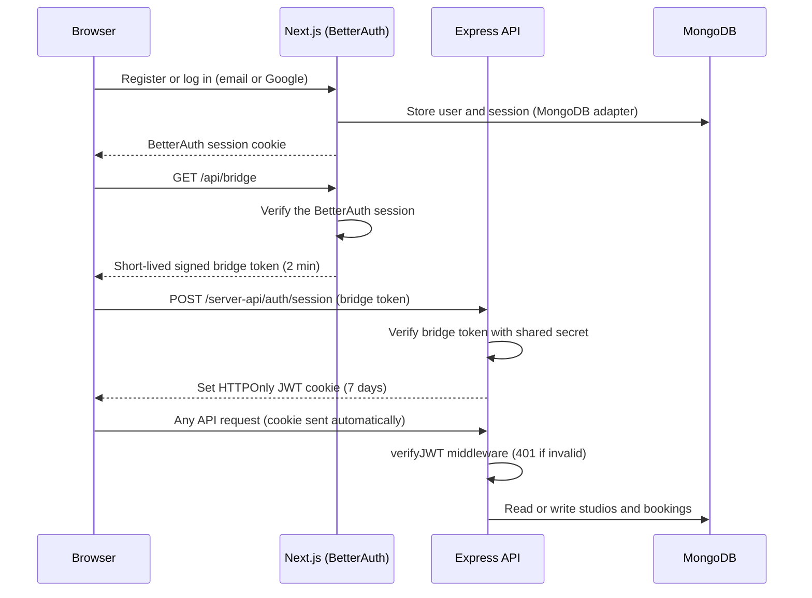
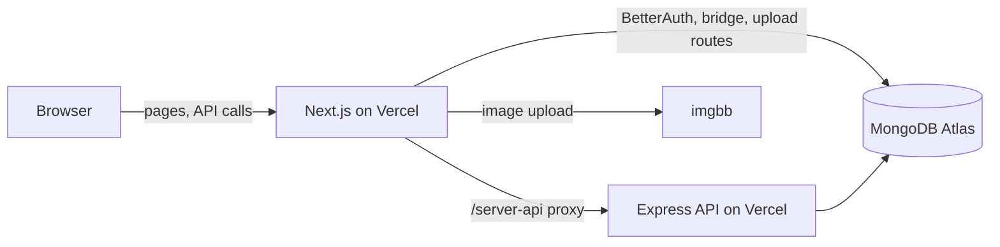

<div align="center">

# StudioSpace


### Find the space. Make the work.

A peer-to-peer marketplace where creators discover, book, and host photo studios, film stages, podcast lounges, music suites, and art workshops by the hour.

[](https://studiospace-client-iycx.vercel.app)
[](https://studiospace-server-taupe.vercel.app)


**Live site:** https://studiospace-client-iycx.vercel.app
**Client repository:** https://github.com/shahed-ab/studiospace-client
**Server repository:** https://github.com/shahed-ab/studiospace-server

</div>

---

## Table of Contents

- [Quick Start for Examiners](#quick-start-for-examiners)
- [Features](#features)
- [Challenges Completed](#challenges-completed)
- [Optional Features Completed](#optional-features-completed)
- [Tech Stack](#tech-stack)
- [How Authentication Works](#how-authentication-works)
- [Architecture](#architecture)
- [API Overview](#api-overview)
- [Project Structure](#project-structure)
- [Local Setup](#local-setup)
- [Environment Variables](#environment-variables)
- [Deployment](#deployment)
- [Design Decisions](#design-decisions)
- [Author](#author)

---

## Quick Start for Examiners

Open the live site: **https://studiospace-client-iycx.vercel.app**


### Test credentials

| Role | Email | Password | What to try |
|---|---|---|---|
| **Host** | `host@studiospace.demo` | `Studio123` | My Studio Listings (4 seeded studios), add, edit, delete, and confirm incoming booking requests on the Dashboard |
| **Guest** | `guest@studiospace.demo` | `Studio123` | Book a studio, view My Bookings, cancel a pending booking, download an invoice for a confirmed booking |

> [!NOTE]
> Email and password login is the quickest way to test. Google sign-in is also implemented with BetterAuth. It works on `localhost`, and on the live site it depends on Google's OAuth consent screen settings.

### A 3-minute walkthrough

1. Log in as the **guest**, open **Explore Studios**, search, filter, and sort.
2. Open a studio and click **Book Workspace Now**. Pick a date and time, and confirm.
3. Open **My Bookings** and see the new booking with a **Pending** badge.
4. Log in as the **host** (use a second browser or a private window), open the **Dashboard**, and **Confirm** that booking.
5. As the guest, try to book an **overlapping time** on the same studio. The server rejects it with a clear message (double-booking prevention).
6. As the guest, open **My Bookings** and download the **PDF invoice** for the confirmed booking.
7. Toggle **light/dark** mode and resize the window to see the responsive layout.

---

## Features

**Discovery**
- Cinematic home page with a Swiper hero slider (3 slides), featured studios (top 6 from MongoDB), category browsing, a "How Booking Works" flow, and a Host Guarantee section
- Explore page with live search, category filter, price range, sorting (top rated, price low to high, price high to low, newest), pagination, and URL-based filters, so results survive a refresh and can be shared
- Studio details page with a gallery, amenities, host profile, ratings and reviews, security deposit, capacity, and a booking modal with an automatic price calculation

**Hosting**
- Add, edit, and delete your own studios, with a form that includes category, pricing, deposit, capacity, location, amenities, and a detailed overview
- Image upload through imgbb (or paste an image URL), with a live preview
- My Studio Listings page, filtered by the owner's email, with a confirmation modal before deleting
- Host dashboard with stats and booking requests that can be confirmed or declined

**Booking**
- Reservations saved with a **Pending** status, then moved through **Confirmed**, **Completed**, and **Cancelled**
- My Bookings page with color-coded status badges and cancellation for pending bookings
- Server-side price calculation (prices from the client are never trusted)

**Experience**
- Branded skeleton loaders on every data fetch and route transition
- Friendly empty states with call-to-action buttons
- Sonner toasts for every success and error, and custom modal dialogs, with no browser `alert()` anywhere
- Custom 404 page with a "Return to Home" button
- Fully responsive for mobile, tablet, and desktop, with a light and dark theme
- Logged-in users stay logged in after a page reload on any private route

---

## Challenges Completed

| Challenge | What was built | How to verify |
|---|---|---|
| **1. JWT security with HTTPOnly cookies** | The Express API issues its own JWT in an HTTPOnly cookie. Every mutation (`POST /api/studios`, `DELETE /api/studios/:id`, `POST /api/bookings`, and the rest) goes through a `verifyJWT` middleware that returns `401 Unauthorized` when the cookie is missing or invalid. | Open `https://studiospace-server-taupe.vercel.app/api/auth/me` in a browser without logging in. It returns `Unauthorized`. |
| **2. Double-booking prevention** | Before saving a booking, and again when a host confirms one, the server checks for a time overlap against existing **Confirmed** bookings for the same studio and date (`newStart < existingEnd AND newEnd > existingStart`). A collision returns `409` with a clear message. | Confirm one booking as the host, then try to book an overlapping time as the guest. |
| **3. Theme customization** | A light and dark theme toggle that restyles the whole application using CSS variables and `next-themes`. | Click the sun and moon icon in the navbar. |

---

## Optional Features Completed

- **PDF booking invoice:** a downloadable, branded receipt generated in the browser for confirmed bookings
- **Saved studios wishlist:** a heart icon on studio cards that saves favorites to MongoDB, with a dedicated Saved Studios page

---

## Tech Stack

| Layer | Technology |
|---|---|
| **Frontend** | Next.js 14 (App Router), TypeScript, Tailwind CSS, shadcn/ui, Swiper, react-hook-form with zod, Sonner, next-themes, lucide-react, react-icons |
| **Authentication** | BetterAuth (email and password, Google OAuth) with the MongoDB adapter |
| **API security** | JWT in an HTTPOnly cookie, verified by Express middleware |
| **Backend** | Node.js, Express.js (JavaScript), Mongoose |
| **Database** | MongoDB Atlas |
| **Image upload** | imgbb (through a server route, so the API key stays private) |
| **PDF** | jsPDF |
| **Hosting** | Vercel (client and server as two separate projects) |

---

## How Authentication Works

Authentication was designed so that the browser never touches a token, and the API never touches a password.



- **BetterAuth** owns the users, passwords, sessions, and Google sign-in inside the Next.js app.
- A **short-lived bridge token** proves to the Express API that BetterAuth really authenticated the user. The server never trusts an email or name sent in a plain request.
- The API then issues its **own JWT in an HTTPOnly cookie**, so JavaScript on the page can never read it.
- A **same-origin proxy** (`/server-api/*` rewritten to the Express API) makes the cookie first-party, so it works in every browser, including those that block third-party cookies.
- On page load, if a BetterAuth session exists but the API cookie has expired, the app silently renews it, so a logged-in user is never sent back to the login page after a reload.

---

## Architecture



Two repositories, deployed as two Vercel projects:

| Repository | Responsibility |
|---|---|
| [`studiospace-client`](https://github.com/shahed-ab/studiospace-client) | UI, routing, BetterAuth, image upload, PDF invoices |
| [`studiospace-server`](https://github.com/shahed-ab/studiospace-server) | REST API, JWT security, booking rules, MongoDB models |

---

## API Overview

Base URL: `https://studiospace-server-taupe.vercel.app/api`

| Method | Endpoint | Access | Purpose |
|---|---|---|---|
| GET | `/studios` | Public | List studios with search, category, price range, sort, and pagination (`limit=6&sort=top` for featured) |
| GET | `/studios/stats/categories` | Public | Studio count per category |
| GET | `/studios/:id` | Public | Studio details |
| GET | `/studios/:id/availability` | Public | Confirmed time ranges for a date |
| POST | `/auth/session` | Bridge token | Exchange a verified bridge token for the HTTPOnly JWT cookie |
| POST | `/auth/logout` | Public | Clear the cookie |
| GET | `/auth/me` | **Protected** | Current user |
| POST | `/studios` | **Protected** | Create a studio |
| GET | `/my-studios` | **Protected** | Studios owned by the current user |
| PUT | `/studios/:id` | **Protected, owner** | Update a studio |
| DELETE | `/studios/:id` | **Protected, owner** | Delete a studio |
| POST | `/bookings` | **Protected** | Create a booking (price calculated on the server, overlap checked) |
| GET | `/bookings/my` | **Protected** | The current user's bookings |
| GET | `/bookings/host` | **Protected** | Bookings on the current user's studios |
| PATCH | `/bookings/:id/cancel` | **Protected** | Cancel a pending booking |
| PATCH | `/bookings/:id/status` | **Protected, host** | Confirm, complete, or cancel a booking |
| POST | `/studios/:id/reviews` | **Protected** | Add a review (requires a completed booking) |
| GET | `/dashboard/stats` | **Protected** | Host and guest statistics |
| GET, POST, DELETE | `/wishlist` | **Protected** | Saved studios |

Protected routes return `401 Unauthorized` without a valid cookie, and `403 Forbidden` when the user does not own the resource.

---

## Project Structure

```
studiospace-client/
├── app/
│   ├── (public)/          Home, Explore, Studio details, Login, Register, About, How It Works
│   ├── (private)/         Dashboard, Add Studio, My Listings, Edit Studio, My Bookings, Wishlist
│   ├── api/               BetterAuth handler, bridge route, image upload route
│   ├── not-found.tsx      Custom 404 page
│   └── layout.tsx         Providers, navbar, footer, toaster
├── components/            Shared UI, layout, studio, and booking components
├── context/               Auth context
├── lib/                   API client, auth config, invoice generator, helpers
├── types/                 TypeScript models
└── public/                Logo and static assets
```

```
studiospace-server/
├── config/                Cached MongoDB connection
├── controllers/           Auth, studios, bookings, dashboard, wishlist
├── middleware/            verifyJWT, error and not-found handlers
├── models/                Studio, Booking, Wishlist
├── routes/                Route definitions
├── scripts/               Seed script and test bridge-token generator
├── utils/                 Validation and time helpers
└── server.js              Express app (serverless-ready default export)
```

---

## Local Setup

**Prerequisites:** Node.js 18 or newer, a free MongoDB Atlas cluster, and (optional) Google OAuth credentials and an imgbb API key.

### 1. Clone both repositories

```bash
git clone https://github.com/shahed-ab/studiospace-server.git
git clone https://github.com/shahed-ab/studiospace-client.git
```

### 2. Start the server

```bash
cd studiospace-server
npm install
cp .env.example .env      # then fill in the values (see below)
npm run seed              # inserts 12 sample studios
npm run dev               # runs on http://localhost:5000
```

### 3. Start the client

```bash
cd studiospace-client
npm install
cp .env.example .env.local   # then fill in the values (see below)
npm run dev                  # runs on http://localhost:3000
```

Open http://localhost:3000. Register an account, or use the seeded host email `host@studiospace.demo` after registering it.

---

## Environment Variables

Names only. Never commit real values.

**Server (`studiospace-server/.env`)**

| Variable | Description |
|---|---|
| `PORT` | Port for local development (default `5000`) |
| `NODE_ENV` | `development` or `production` (controls cookie security flags) |
| `MONGODB_URI` | MongoDB Atlas connection string, including the `/studiospace` database name |
| `JWT_SECRET` | Secret used to sign the API's session JWT |
| `AUTH_BRIDGE_SECRET` | Shared secret used to verify the bridge token (must match the client) |
| `CLIENT_URL` | Allowed client origin(s) for CORS, comma-separated, no trailing slash |

**Client (`studiospace-client/.env.local`)**

| Variable | Description |
|---|---|
| `MONGODB_URI` | Same database as the server (BetterAuth stores users here) |
| `BETTER_AUTH_SECRET` | BetterAuth's own secret |
| `BETTER_AUTH_URL` | The public URL of the client (`http://localhost:3000` locally) |
| `GOOGLE_CLIENT_ID` / `GOOGLE_CLIENT_SECRET` | Google OAuth credentials |
| `AUTH_BRIDGE_SECRET` | Same value as the server |
| `API_URL` | Base URL of the Express API (used by the proxy rewrite) |
| `IMGBB_API_KEY` | imgbb key for image uploads |

---

## Deployment

- Both projects are deployed on **Vercel**: the client as a Next.js project, and the server as a serverless Express project.
- The server connects to MongoDB lazily and reuses the connection between requests, which suits serverless functions.
- In production the API cookie is `HttpOnly`, `Secure`, and `SameSite=None`, and CORS allows only the configured client origin with credentials.
- Environment variables are set in each Vercel project, and any change is followed by a redeploy.

---

## Design Decisions

- **Backstage design system:** a dark-first, photography-led interface with a spotlight-orange accent, built from CSS variables, with a matching light theme.
- **One data layer:** every page reads and writes data through a single API module, so the UI never depends on how or where the data is stored.
- **Server owns the rules:** ownership, pricing, and booking overlaps are all checked on the server, and never trusted from the browser.
- **Consistency by construction:** shared components for headings, buttons, sections, and cards keep spacing, typography, and equal-height card grids consistent on every page.
- **Resilient loading:** skeletons, empty states, and error states exist wherever data is fetched.

---

## Author

**Shahed**
GitHub: [@shahed-ab](https://github.com/shahed-ab)
LinkedIn: _add your LinkedIn link here_
Email: _add your email here_

Built as a full-stack assignment project. Feedback and questions are welcome.
